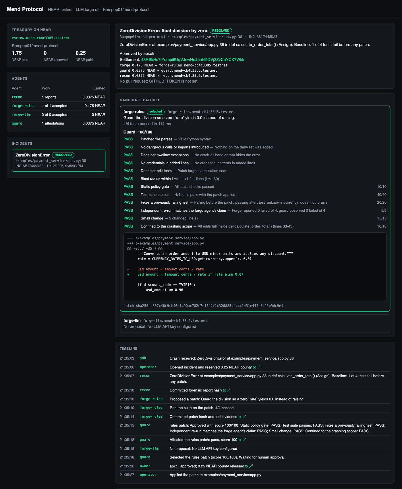

# Mend Protocol

**Fix production bugs from your phone, without opening a laptop.**

When your Python app crashes, a team of AI agents finds the broken line, writes a fix and tests it. An independent guard agent checks the fix, and the fix comes to you on Telegram. You approve with one tap or one wallet signature. The fix arrives as a GitHub pull request, and a smart contract on NEAR pays the agents that did the work. Nothing is paid or merged without your approval.

Built for NEAR HACKATHON: Build Beyond Boundaries. Tracks: **AI Swarms**, **Agent Economy**, **AI Security & Defense**.

| | |
| --- | --- |
| **Try it now** | [@mend_protocol_bot](https://t.me/mend_protocol_bot) on Telegram, no install |
| **Escrow contract** | [`escrow.mend-cb4c33d5.testnet`](https://testnet.nearblocks.io/address/escrow.mend-cb4c33d5.testnet) on NEAR testnet |
| **Demo repository** | [Rampop01/mend-demo-shop](https://github.com/Rampop01/mend-demo-shop), a checkout API with a real bug |
| **A fix Mend delivered** | [Pull request #1](https://github.com/Rampop01/mend-demo-shop/pull/1) and its [on-chain payout](https://testnet.nearblocks.io/txns/8E7v3FoMU6jq4P88JkZZ2Rcv4BTub7FDqcM3HRbi3Pst) |



## Contents

- [Try it in two minutes](#try-it-in-two-minutes)
- [The problem](#the-problem)
- [How Mend works](#how-mend-works)
- [What NEAR does](#what-near-does)
- [Proof on-chain](#proof-on-chain)
- [Safety](#safety)
- [Protect your own project](#protect-your-own-project)
- [Run your own Mend server](#run-your-own-mend-server)
- [How the guard scores a fix](#how-the-guard-scores-a-fix)
- [Architecture](#architecture)
- [Limits and roadmap](#limits-and-roadmap)
- [Hackathon disclosure](#hackathon-disclosure)

## Try it in two minutes

Mend runs as a public service. You need a Telegram account and a GitHub account. A NEAR wallet is optional.

1. **Open [@mend_protocol_bot](https://t.me/mend_protocol_bot) and send `/start`.**
   You get a short explanation and three buttons.
2. **Tap _1. Connect GitHub_.**
   The bot sends a code and a link to github.com/login/device. Enter the code and approve *Mend Protocol*. It asks for access to your **public** repositories only. The bot replies "Connected to GitHub as *you*".
3. **Optional: tap _2. Connect NEAR wallet_.**
   A page opens where you connect Meteor, MyNearWallet or Intear on **testnet**. The bot shows your account and balance. Need testnet NEAR? It's free from the [NEAR faucet](https://docs.near.org/getting-started/faucet).
4. **Tap _3. Try the demo_.**
   Mend forks the demo shop into your GitHub, runs its tests, and asks who funds the repository's bounty treasury:
   - **🔐 Use my NEAR wallet.** Your wallet signs one transaction that deposits 0.2 testnet NEAR and makes **you** the treasury's owner.
   - **🎁 Let Mend fund it.** No wallet needed; Mend deposits testnet NEAR for you.
5. **Watch the crash and the fix.**
   Mend checks out the shop with the coupon `SAVEBIG`, which crashes it with `ValueError`. About 30 seconds later a card shows the AI's fix, the test results (6/6 pass, where 1 failed before) and the guard's score.
6. **Approve.**
   If you funded the treasury with your wallet, the button opens the page and your **wallet signs** the payout. Otherwise you tap Approve in Telegram. The card then lists the payouts to the agents with a link to the transaction, and a **pull request** appears on your fork.

Daily limits per user: 3 `/try`, 10 incidents, 3 connected repositories. `/status` shows your wallet balance and your treasuries.

## The problem

Production bugs don't wait until you're at your desk. When a service crashes at night, monitoring tools page someone, and that person has to find a laptop, read logs and write a fix by hand.

AI can write code, but on its own it answers none of the questions that matter in production:

- **Is the fix correct?** Someone has to run the tests and check the AI didn't just hide the error.
- **Is it safe?** AI-written code could do anything, and someone has to look.
- **Who decides?** The person responsible for the service should approve every change.
- **Who pays for the work?** If AI agents are going to do real work, they need a fair, verifiable way to get paid.

## How Mend works

```
 Your app crashes
        │  the Mend SDK reports the exception (2 lines of code in your app)
        ▼
 ┌───────────────┐  Opens an incident on NEAR and locks a bounty from the repository's treasury
 │   operator    │
 └───────┬───────┘
         ▼
 ┌───────────────┐  Finds the failing line and runs your tests to see which already fail
 │     recon     │  → signs a hash of its report on NEAR
 └───────┬───────┘
         ▼
 ┌───────────────┐ ┌───────────────┐  Two repair agents compete on a fix:
 │  forge-rules  │ │   forge-llm   │  proven rewrites vs. an AI model on NEAR AI Cloud
 └───────┬───────┘ └───────┬───────┘  → each signs its patch hash and test results on NEAR
         └────────┬────────┘
                  ▼
 ┌───────────────┐  Blocks unsafe code before it runs, re-runs every test itself,
 │     guard     │  scores each patch out of 100 → signs its verdict on NEAR
 └───────┬───────┘
         ▼
   You, on Telegram: the exact diff, the evidence, one tap or one wallet signature
         │
         ├──▶ NEAR: the contract pays the agents (70% fixer · 15% guard · 15% recon)
         └──▶ GitHub: the fix arrives as a pull request
```

| Agent | Job | Paid |
| --- | --- | --- |
| **recon** | Locates the crash in the code, records which tests fail before any change | 15% |
| **forge-rules** | Applies a proven fix for known crash types (division by zero, missing key, `None` access); declines otherwise | 70% if its fix is chosen |
| **forge-llm** | Asks an AI model for a minimal fix | 70% if its fix is chosen |
| **guard** | Independent reviewer: safety checks, its own test run, a score | 15% |

The best-scoring passing fix is offered to you. If nothing passes, or you reject it, the bounty goes back to the treasury and nobody is paid.

## What NEAR does

NEAR holds the money and the rules, so payment is enforced by the contract.

- **An escrow contract holds each repository's bounty treasury.** It is written in Rust with near-sdk ([source](contracts/bounty_escrow/src/lib.rs), 14 unit tests). It pays only when all three conditions hold on-chain:
  1. the fixing agent reported a clean test run;
  2. the guard attested a pass for **that exact patch** (by hash);
  3. the treasury's owner approved **that same patch hash**.
- **Every agent has its own NEAR account.** The chain records who did what and who earned what. The contract refuses a guard that is also a fixer.
- **Agent keys can only call one function.** Each agent signs with a *function-call access key* limited to one contract method and a gas allowance. A stolen agent key cannot move money. Mend's operator key can open and reject incidents but **cannot approve a payout**.
- **Spending limits.** Each treasury has a maximum bounty per incident that the operator cannot exceed.
- **You can own the money.** Choose which way a repository's treasury is funded:

| | 🔐 Your NEAR wallet | 🎁 Funded by Mend |
| --- | --- | --- |
| Who owns the treasury on-chain | **You** | Mend |
| Who signs each payout | **Your wallet** (a Telegram tap cannot pay out) | Mend, when you tap Approve in Telegram |
| What you need | A testnet wallet and ~0.3 testnet NEAR | Nothing |
| Unused funds | Yours to withdraw at any time | Stay with Mend |

## Proof on-chain

**A complete fix on a real repository.** In [Rampop01/mend-demo-shop](https://github.com/Rampop01/mend-demo-shop), the coupon `SAVEBIG` crashed checkout. The rule-based agent had no rule for this crash, and the AI agent's fix passed 6/6 tests with a guard score of 100. It was approved from Telegram and delivered as [pull request #1](https://github.com/Rampop01/mend-demo-shop/pull/1).

| Step | Signed by | Transaction |
| --- | --- | --- |
| Open the incident, lock a 0.25 NEAR bounty | operator | [7UpBzD…](https://testnet.nearblocks.io/txns/7UpBzD2SJa7MS2ED58gBeYkUY6ULNYSFskJfcbvR9vwo) |
| Commit the recon report hash | recon | [FodXJA…](https://testnet.nearblocks.io/txns/FodXJAK5Wg72AkzJhKntajZEG6oh6oKGW1KmZsWs1m1n) |
| Commit the patch hash and test results | forge-llm | [6fdta7…](https://testnet.nearblocks.io/txns/6fdta7PtQgzBGK9hYGhCeaGfZyXPZyWe6Ks9ny3Y3MLE) |
| Attest the patch, score 100 | guard | [E3S1NT…](https://testnet.nearblocks.io/txns/E3S1NT3ygwvG6cx7P2CdePVN9FT2TQTUAm9uvD5bPs2S) |
| Approve; pay 0.175 / 0.0375 / 0.0375 NEAR | owner | [8E7v3F…](https://testnet.nearblocks.io/txns/8E7v3FoMU6jq4P88JkZZ2Rcv4BTub7FDqcM3HRbi3Pst) |

**The wallet path.** A brand-new testnet account played a user's wallet. It [opened its own treasury](https://testnet.nearblocks.io/txns/CJWj9ggToAx53xH1pdy4m4XN7tYDH4kpBPEJbvqyjQKV), the agents fixed the crash, a Telegram approval was refused, and the agents were paid only after [the wallet signed](https://testnet.nearblocks.io/txns/CUEcdGHnwGN9xQhPBeTwBuF4rZns2HLj7U3DNoJ1wSeK).

All accounts and setup transactions are listed in [deployments/testnet.json](deployments/testnet.json).

## Safety

Mend runs code it didn't write (your tests and AI-written patches) on behalf of people it doesn't know, so it is built defensively:

- **Patches are screened before they ever run.** The guard rejects a patch that adds dangerous calls (`eval`, `exec`, `os.system`, `subprocess`, sockets), adds a catch-all `except` that hides the error, contains a credential, edits a test, or changes more than 60 lines.
- **Tests run in a locked-down container** on the public service. Each run gets no network, a read-only system, no secrets, a non-root user, and capped memory, CPU and processes. Dependencies from `requirements.txt` are installed once, separately, and mounted read-only.
- **The guard doesn't trust the fixer.** It re-runs the tests itself and checks its numbers match what the fixing agent claimed.
- **Your code is never changed without you.** On a connected repository a fix is only a pull request, opened with your own GitHub access after you approve. Mend never pushes to your main branch.
- **GitHub tokens** are limited to public repositories and encrypted at rest. `/disconnect` deletes yours.
- **App tokens are scoped.** The token you put in your app can only report crashes for that one repository.
- **Wallet claims are checked on-chain.** Links to the wallet page are signed and expire, and Mend verifies every claim the page makes (treasury owner, approval, patch hash) against the chain before acting.
- **Stale crashes are not "fixed" twice.** If the crashing line no longer matches the code on GitHub, the incident is closed without payment.
- **Abuse limits:** daily quotas per user, and one request at a time.

## Protect your own project

Your project needs to be a **public GitHub repository** written in **Python** with a test suite (pytest or unittest).

1. In the bot, send `/watch your-name/your-repo`.
   Mend copies the repository, runs its tests, asks how to fund the treasury, and replies with a token and this snippet.
2. Add the snippet to your app:
   ```bash
   pip install git+https://github.com/Rampop01/Mend-Protocol.git
   ```
   ```python
   from mend.sdk import init_mend

   init_mend(
       endpoint="https://34-140-240-192.sslip.io/api/v1/incidents",
       token="mend_…",          # from the bot; keep it private
       repo="your-name/your-repo",
   )
   ```
   `init_mend` reports any uncaught exception. To watch one function or one block instead, use `MendWatch` as a decorator or a `with` block. Local variables whose names look like secrets (`password`, `token`, `key`, …) are redacted before anything is sent.
3. When your app crashes, the fix card comes to Telegram, and after you approve, the fix arrives as a pull request.

## Run your own Mend server

Everything above runs from this repository. You need Python 3.9+ on macOS or Linux. Rust is needed only to rebuild the contract, because a built `.wasm` is included.

```bash
git clone https://github.com/Rampop01/Mend-Protocol.git && cd Mend-Protocol
python3 -m venv .venv && source .venv/bin/activate
pip install -e .
```

**1. Run the tests.**

```bash
python -m unittest discover -s tests -t .
```

Expect `Ran 87 tests` and `OK`. The tests cover the whole pipeline against real temporary git repositories, including:
- a stranger running `/try`, where a different user's Approve tap is refused;
- a hostile AI patch, which is blocked before it executes;
- a wallet-owned treasury, which only a wallet signature can pay out.

The contract has its own tests: `cd contracts/bounty_escrow && cargo test` (14 tests).

**2. Create your own testnet deployment.**

```bash
python -m mend setup
```

This takes about a minute and prints `Setup complete. Contract: https://testnet.nearblocks.io/address/escrow.mend-….testnet`. It creates a funded owner account from the testnet faucet, deploys the contract, and creates the four agent accounts with single-method keys. Keys go to `.mend/testnet.json`, which git ignores. You can skip this step; Mend then runs without escrow and says so on every incident.

**3. Start the server and crash the example service.**

```bash
python -m mend serve                          # dashboard at http://127.0.0.1:8770
python examples/payment_service/app.py        # in a second terminal
```

The example prints `Checkout crashed: ZeroDivisionError`. Within about 15 seconds the dashboard shows the fix awaiting approval, with the guard's checks and a link for every transaction. Approve it in the dashboard, or with `python -m mend approve INC-…`. Restore the bug with `git checkout examples/payment_service/app.py`.

**4. Connect a GitHub repository instead of the example.**

```bash
gh auth login                                 # or set GITHUB_TOKEN in .env
python -m mend connect your-name/your-repo    # prints the SDK snippet with its token
```

### Configuration

Copy `.env.example` to `.env`. Every setting is optional, and the server logs which features are on when it starts.

| Variable | What it does |
| --- | --- |
| `NEAR_AI_API_KEY` | Turns on the AI repair agent (`forge-llm`) through [NEAR AI Cloud](https://cloud.near.ai). Without it only `forge-rules` competes. |
| `TELEGRAM_BOT_TOKEN`, `TELEGRAM_CHAT_ID`, `TELEGRAM_APPROVER_IDS` | Sends fix cards to a Telegram chat, with buttons that only the listed approvers can use. |
| `GITHUB_TOKEN` | Opens pull requests. Defaults to your `gh auth login` session. |
| `MEND_INGEST_TOKEN` | Admin token for the API. Required to listen on anything other than localhost. |
| `MEND_PUBLIC=1` with `MEND_SECRET_KEY`, `GITHUB_CLIENT_ID`, `MEND_PUBLIC_URL` | Runs the public multi-user service: anyone can use the bot, with GitHub sign-in through an OAuth App that has Device Flow enabled. |
| `MEND_SANDBOX=docker` | Runs every test suite in the locked-down container. Build it with `docker build -t mend-sandbox -f deploy/sandbox.Dockerfile deploy`. |
| `MEND_BOUNTY_NEAR`, `MEND_TREASURY_DEPOSIT_NEAR`, `MEND_MAX_BOUNTY_NEAR` | Bounty size, Mend-funded treasury size, and the per-incident spending limit. |

`deploy/provision.sh` sets up the public service on a fresh Ubuntu server, with HTTPS by Caddy and auto-restart by systemd.

## How the guard scores a fix

A patch that passes the safety screen is scored out of 100:

| Check | Points |
| --- | --- |
| The guard's own run of the test suite passes | 40 |
| A test that failed before the patch now passes | 20 |
| The change is small: 10 lines or fewer for full marks, falling to 0 at 60 | 15 |
| The edits stay inside the function that crashed | 10 |
| The safety screen is clean | 10 |
| The guard's test counts match what the fixing agent reported | 5 |

The highest score wins; a tie goes to the smaller change.

## Architecture

```text
contracts/bounty_escrow/   Rust escrow contract (near-sdk 5) and its tests
mend/sdk/                  Crash reporter for your app (standard library only)
mend/swarm/                recon, forge (rules + LLM) and guard agents, and the orchestrator
mend/integrations/         NEAR transaction signing and RPC, escrow client, GitHub, LLM
mend/bot/                  Telegram bot: commands, fix cards, approvals
mend/hosted.py             Public service: GitHub sign-in, /try, /watch, treasury funding
mend/web/                  Dashboard and NEAR wallet page (NEAR Wallet Selector v10)
mend/sandbox.py            Runs tests in a throwaway copy, in a container on the public service
mend/server.py, cli.py     HTTP API and command line
deploy/                    Sandbox image, systemd service, server provisioning
examples/payment_service/  Small example with a real bug, for running locally
tests/                     87 tests
```

Transaction encoding and signing are implemented in Python using only the standard library plus PyNaCl for ed25519 signatures, with no NEAR SDK on the server. Every transaction hash Mend shows comes back from the NEAR RPC and can be opened in an explorer.

## Limits and roadmap

**Today**
- **Testnet only.** The contract has unit tests but no audit.
- **Python only.** The recon agent and the guard's static checks read Python code. The AI agent, sandbox, escrow and Telegram flow work for any language.
- **Public repositories only** on the public service.
- **Mend-funded treasuries** are paid out by Mend's key when you tap Approve. Choose your own wallet to keep that in your hands.
- With the AI agent enabled, the crashing file's source is sent to NEAR AI Cloud.

**Next**
- **Mainnet:** the wallet path already keeps money in the user's hands, so this needs a contract audit and configuration.
- **JavaScript and TypeScript:** an SDK for Node and a language-neutral recon.
- **Private repositories:** through a GitHub App with per-repository permissions.

## Hackathon disclosure

- All code in this repository was written between 7 and 14 November 2026, during the hackathon. There is no earlier baseline.
- Libraries: [near-sdk](https://crates.io/crates/near-sdk) (contract), [PyNaCl](https://pypi.org/project/PyNaCl/) (signing), [NEAR Wallet Selector](https://github.com/near/wallet-selector) (wallet page), Caddy and Docker (deployment). The AI agent uses models through [NEAR AI Cloud](https://cloud.near.ai).
- AI coding assistants were used to write parts of this code.

## License

MIT. See [LICENSE](LICENSE).
